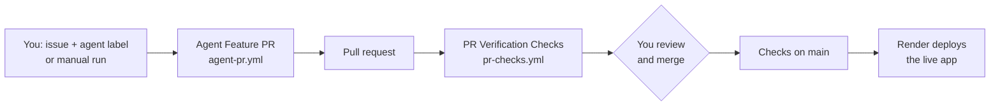

# SpotRadar

SpotRadar is a web application built with TypeScript: a REST API backend and a browser frontend that share one typed API contract.
It deliberately has no database – state lives in memory or in a local JSON file on the backend – which keeps it simple to run, test and host for free.

The app is developed mainly by AI agents (Claude Code) running in GitHub Actions: you describe a feature, an agent implements it and opens a pull request, automated checks verify it, and after merge it is deployed automatically.

**Live app:** https://spotradar.onrender.com
_(on the free plan the first request after 15 minutes of inactivity takes about a minute while the app wakes up)_

## What it does

Pick a **sport** (tennis, badminton, squash, table tennis, padel, beach volleyball), a **date**, a **start time** and a **duration**, and optionally share your **location** with a **max distance**. SpotRadar lists the venues in Brno that have a free court for exactly that slot (nearest or cheapest first), and you can reserve the court right away. No more checking ten booking websites.

> **Demo data:** the venues are fictional and the occupancy from external booking systems is simulated (deterministic per court/date/slot). Reservations made in SpotRadar are kept in memory and reset on every restart or deploy.

### API (contract in `shared/src`)

| Method | Path                     | Success                      | Errors                                                                                                                                                    |
| ------ | ------------------------ | ---------------------------- | --------------------------------------------------------------------------------------------------------------------------------------------------------- |
| GET    | `/api/health`            | 200 `{ status: 'ok' }`       | –                                                                                                                                                         |
| GET    | `/api/availability`      | 200 `AvailabilityResponse`   | 400 `VALIDATION_ERROR`, 422 `DATE_OUT_OF_RANGE`                                                                                                           |
| POST   | `/api/reservations`      | 201 `Reservation`            | 400 `VALIDATION_ERROR`, 404 `VENUE_NOT_FOUND` / `COURT_NOT_FOUND`, 409 `SLOT_UNAVAILABLE`, 413, 422 `SPORT_NOT_OFFERED` / `DATE_OUT_OF_RANGE` / `SLOT_IN_PAST` / `OUTSIDE_OPENING_HOURS` |
| GET    | `/api/reservations/:id`  | 200 `Reservation`            | 404 `RESERVATION_NOT_FOUND`                                                                                                                               |

`/api/availability` query: `sport`, `date` (YYYY-MM-DD, today … today + 13 days, Europe/Prague), `time` (HH:00 or HH:30), `durationMinutes` (60/90/120, default 60), `cityId` (default `brno`), optional `lat` + `lng`, optional `maxDistanceKm` (requires `lat`/`lng`).

### Toolchain (no third-party dependencies yet)

The first version was built in an environment where `npm install` was not available, so it uses only Node 22 built-ins:
TypeScript runs directly via Node's type stripping (erasable syntax only, relative imports with `.ts` extensions), tests use `node:test`,
the backend uses `node:http`, and the frontend is vanilla TypeScript turned into browser ES modules by `frontend/scripts/build.mjs`
(with an import map for `@spotradar/shared`). **Not set up yet:** `typecheck` (TypeScript), `lint` (ESLint) and Playwright E2E tests –
these need dev dependencies to be installed and the lockfile updated.

## Repository structure

```text
spotradar/
├── shared/              # API contract: shared TypeScript types, DTOs and validation schemas
├── backend/             # REST API server (serves /api and the built frontend), integration tests
├── frontend/            # Web UI, component tests and Playwright E2E tests
├── .claude/
│   ├── agents/          # AI agent definitions (team-lead, backend-dev, frontend-dev, qa-reviewer)
│   ├── rules/           # Coding rules applied when agents work in backend/ or frontend/
│   └── settings.json    # Agent permissions and hooks (auto-format, checks before finishing)
├── .github/workflows/
│   ├── agent-pr.yml     # AI agent implements a task and opens a PR
│   └── pr-checks.yml    # Typecheck, lint, tests, build, E2E
├── .mcp.json            # Playwright MCP server – lets agents use a real browser
├── render.yaml          # Free deployment on Render
├── CLAUDE.md            # Project rules for humans and AI agents
└── package.json         # npm workspaces root and shared scripts
```

The project is **contract-first**: every feature starts with types and validation schemas in `shared/`, which both `backend/` and `frontend/` import – so the API and the UI cannot drift apart.

## How the AI workflow works



### 1. Agent Feature PR (`agent-pr.yml`)

Started from a GitHub issue:

1. Open an issue – the **title** becomes the PR title, the **body** is the full task in plain language.
2. Add the **`agent`** label. The workflow starts, comments the run link on the issue and, when done, comments the PR link (or the failure).
3. The PR contains `Closes #<issue>`, so merging it closes the issue. To retry, remove and re-add the label.

Only issues written by the repository owner or collaborators are picked up, because the issue body becomes the agent's prompt.
It can also be started manually: **Actions → Agent Feature PR → Run workflow** with a `task`.
The agent always writes and runs Playwright E2E tests.

The workflow creates a new branch and runs Claude Code (Opus) as the **team-lead** agent, which:

1. designs the types and validation schemas in `shared/` and freezes them as the contract,
2. hands the backend and frontend parts to the **backend-dev** and **frontend-dev** agents, which work in parallel (small single-folder changes it does itself),
3. integrates the result, runs typecheck, lint and tests and fixes failures,
4. asks the **qa-reviewer** agent for a final review (at most 2 rounds).

The workflow then commits the changes and opens a pull request with a summary of test results. The agent itself is not allowed to commit or push – only the workflow does.

### 2. PR Verification Checks (`pr-checks.yml`)

Runs independently of the agent on every pull request and every push to `main`:
typecheck → lint → unit & integration tests → build → E2E tests (Playwright).
Results and logs are shown in the run summary and uploaded as an artifact.

### 3. Deployment (Render)

After a merge, the checks run on `main`; when they pass, Render builds and deploys the app automatically (`render.yaml`, `autoDeployTrigger: checksPass`). There is no separate deploy workflow and no deploy secret.

### AI agents

| Agent          | Model  | Role                                                                                                             |
| -------------- | ------ | ---------------------------------------------------------------------------------------------------------------- |
| `team-lead`    | Opus   | Architect and coordinator – owns the contract in `shared/`, delegates, integrates and coordinates QA.            |
| `backend-dev`  | Sonnet | Implements `backend/` with tests against the frozen contract; never edits `shared/`.                             |
| `frontend-dev` | Sonnet | Implements `frontend/` with tests against the frozen contract; never edits `shared/`.                            |
| `qa-reviewer`  | Sonnet | Read-only reviewer – checks the diff, runs the checks and tests the running app in a browser via Playwright MCP. |

All of them can also be used locally in Claude Code in this repository.

## Local development

Requires Node.js 22.

```bash
npm ci              # install dependencies
npm run dev         # start frontend + backend
npm run typecheck
npm run lint
npm test
npm run test:e2e
npm run build
npm start           # run the production build
```

## One-time setup

- **GitHub secret** `CLAUDE_CODE_OAUTH_TOKEN` (Settings → Secrets and variables → Actions) – used by the agent; generate it locally with `claude setup-token` (works with a Claude Pro/Max subscription).
- **Settings → Actions → General → Allow GitHub Actions to create and approve pull requests.**
- **Render:** sign in at render.com with GitHub → **New → Blueprint** → select this repository.

Development rules for humans and agents are in [`CLAUDE.md`](CLAUDE.md).
