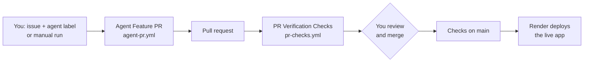

# SpotRadar

SpotRadar is a web application built with TypeScript: a REST API backend and a browser frontend that share one typed API contract.
It deliberately has no database – state lives in memory or in a local JSON file on the backend – which keeps it simple to run, test and host for free.

The app is developed mainly by AI agents (Claude Code) running in GitHub Actions: you describe a feature, an agent implements it and opens a pull request, automated checks verify it, and after merge it is deployed automatically.

**Live app:** https://spotradar.onrender.com
_(on the free plan the first request after 15 minutes of inactivity takes about a minute while the app wakes up)_

## What it does

SpotRadar is a **badminton court finder for Brno** with a **calendar-based UI** ("Court & Shuttle" design, light and dark).
Pick a **sport** in the top menu (badminton for now) and browse availability in a **Day / Week / Month / Year** calendar
(today … +14 days). Every hour cell shows how many venues have a free court (or "check" when only venues without live data
are open). Click an hour to open a panel that lists **every venue's status** (free, check on website, full, closed) with a
**"Book on venue's website"** link. Filters: jump to a date, narrow the visible hours, set a location (browser geolocation
or an address) with a max distance, and "Only show free". **"Next free court"** jumps to the earliest free hour, and a legend
shows which venues have live data. The view and filters are kept in the URL, so links are shareable. Free courts are
**read from the venues' own public booking pages** (where a connector exists) via `GET /api/calendar`.
**SpotRadar never books anything itself** – booking always happens on the venue's website.

Availability is read live (cached for 15 minutes per venue and date) and may be a few minutes old.

### Data sources and connector status

Venues are a static data file in the backend (`backend/src/data/venues.ts`). Each venue declares its booking system
(`availabilitySource`) and a backend-only connector configuration. Connectors implement a pluggable
`AvailabilityConnector` interface, so new booking systems can be added without touching the search logic.

| Venue                  | District          | Courts | Booking system | Connector status              |
| ---------------------- | ----------------- | ------ | -------------- | ----------------------------- |
| Sportcentrum Kuklenská | Brno-Židenice     | 4      | ClubSpire      | ✅ live                       |
| Centrum Viktoria       | Brno-Komárov      | 3      | ClubSpire      | ✅ live                       |
| Badminton Jehnice      | Brno-Jehnice      | 5      | Bizzy          | ⏳ not yet – status `unknown` |
| Badminton Líšeň        | Brno-Líšeň        | 6      | Bizzy          | ⏳ not yet – status `unknown` |
| X-Arena Slatina        | Brno-Slatina      | 6      | Bizzy          | ⏳ not yet – status `unknown` |
| Hala Sprint            | Brno-Královo Pole | 6      | MemberZone     | ⏳ not yet – status `unknown` |
| Sportcentrum Ivanovice | Brno-Ivanovice    | ?      | MemberPro      | ⏳ not yet – status `unknown` |

Availability status per venue: `live` (read from the booking page), `unavailable` (a connector exists but reading failed –
the search still succeeds), `unknown` (no connector yet). Opening hours marked `approximate` are estimates. In the calendar,
venues without live data are shown as **"check on website"** during their opening hours – a free court is never guessed.
The plan for bringing the remaining 5 venues live (one Bizzy connector covers 3 of them) is in
[`docs/live-data-connectors.md`](docs/live-data-connectors.md).

**ClubSpire connector:** fetches the server-rendered day timeline
`{base}/timeline/day?tabIdx={tabIdx}&criteriaTimestamp={local midnight Europe/Prague in epoch ms}&resetFilter=true`
and parses it with cheerio: each court is a `tr[data-row-id]` in `table.schedule`, column start times come from the page
header, `can_book` / `can_book_substitute` cells are free unless also marked `full` / `full_substitute` / `disabled`;
half-hour "zoom" cells are split into sub-slots. It is polite to the venues: `User-Agent: SpotRadar/1.0`, 8 s timeout, at
most one concurrent request per host and a 15-minute cache per venue + date. Tests use sanitized HTML fixtures recorded from
the real pages – never the live sites. Refresh a raw page with
`npm run fetch:clubspire -w @spotradar/backend -- <baseUrl> <tabIdx> <YYYY-MM-DD> <outFile>`.

**Geocoding:** `/api/geocode` proxies [OpenStreetMap Nominatim](https://nominatim.org/) (`countrycodes=cz`,
`User-Agent: SpotRadar/1.0`, in-memory cache, max 1 request per second) in line with the
[Nominatim usage policy](https://operations.osmfoundation.org/policies/nominatim/). Data © OpenStreetMap contributors.

### API (contract in `shared/src`)

| Method | Path            | Success                | Errors                                                                       |
| ------ | --------------- | ---------------------- | ---------------------------------------------------------------------------- |
| GET    | `/api/health`   | 200 `{ status: 'ok' }` | –                                                                            |
| GET    | `/api/search`   | 200 `SearchResponse`   | 400 `VALIDATION_ERROR`, 422 `DATE_OUT_OF_RANGE`                              |
| GET    | `/api/calendar` | 200 `CalendarResponse` | 400 `VALIDATION_ERROR`, 422 `DATE_OUT_OF_RANGE`                              |
| GET    | `/api/geocode`  | 200 `GeocodeResponse`  | 400 `VALIDATION_ERROR`, 404 `LOCATION_NOT_FOUND`, 502 `GEOCODER_UNAVAILABLE` |

`/api/search` query: `sport`, `date` (YYYY-MM-DD, today … today + 14 days, Europe/Prague), optional `time` (HH:MM),
optional `lat` + `lng` (together), optional `maxDistanceKm` (requires `lat`/`lng`). Results list venues with a free court
(at `time`, or anytime that day) first, then sort by distance (or name). `/api/calendar` query: `sport`, `from` + `to`
(YYYY-MM-DD, both inside the search window, `from` ≤ `to`, at most 15 days), optional `lat` + `lng`, optional `maxDistanceKm`;
returns the matching venues plus per-day availability for each. `/api/geocode` query: `q` (2–200 characters).

### Toolchain

TypeScript runs directly via Node 22 type stripping (erasable syntax only, relative imports with `.ts` extensions), tests use
`node:test`, the backend uses `node:http` (+ `cheerio` for HTML parsing), and the frontend is vanilla TypeScript turned into
browser ES modules by `frontend/scripts/build.mjs` (with an import map for `@spotradar/shared`). `typecheck` uses `tsc`
(`tsconfig.base.json`), `lint` uses ESLint (`eslint.config.js`), formatting uses Prettier (`.prettierrc.json`), and E2E tests
use Playwright (`frontend/e2e`) against the backend started in stub mode (`npm run start:e2e -w @spotradar/backend`:
recorded fixtures instead of live booking pages and a fake geocoder).

## Repository structure

```text
spotradar/
├── shared/              # API contract: shared TypeScript types, DTOs and validation schemas
├── backend/             # REST API server (serves /api and the built frontend), integration tests
├── frontend/            # Web UI, component tests and Playwright E2E tests
├── .claude/
│   ├── agents/          # AI agent definitions (team-lead, backend-dev, frontend-dev, qa-reviewer)
│   ├── rules/           # Coding rules applied when agents work in backend/ or frontend/
│   └── settings.json    # Agent permissions and hooks (auto-format, checks before finishing)
├── .github/workflows/
│   ├── agent-pr.yml     # AI agent implements a task and opens a PR
│   └── pr-checks.yml    # Typecheck, lint, tests, build, E2E
├── .mcp.json            # Playwright MCP server – lets agents use a real browser
├── render.yaml          # Free deployment on Render
├── CLAUDE.md            # Project rules for humans and AI agents
└── package.json         # npm workspaces root and shared scripts
```

The project is **contract-first**: every feature starts with types and validation schemas in `shared/`, which both `backend/` and `frontend/` import – so the API and the UI cannot drift apart.

## How the AI workflow works



### 1. Agent Feature PR (`agent-pr.yml`)

Started from a GitHub issue:

1. Open an issue – the **title** becomes the PR title, the **body** is the full task in plain language.
2. Add the **`agent`** label. The workflow starts, comments the run link on the issue and, when done, comments the PR link (or the failure).
3. The PR contains `Closes #<issue>`, so merging it closes the issue. To retry, remove and re-add the label.

Only issues written by the repository owner or collaborators are picked up, because the issue body becomes the agent's prompt.
It can also be started manually: **Actions → Agent Feature PR → Run workflow** with a `task`.
The agent always writes and runs Playwright E2E tests.

The workflow creates a new branch and runs Claude Code (Opus) as the **team-lead** agent, which:

1. designs the types and validation schemas in `shared/` and freezes them as the contract,
2. hands the backend and frontend parts to the **backend-dev** and **frontend-dev** agents, which work in parallel (small single-folder changes it does itself),
3. integrates the result, runs typecheck, lint and tests and fixes failures,
4. asks the **qa-reviewer** agent for a final review (at most 2 rounds).

The workflow then commits the changes and opens a pull request with a summary of test results. The agent itself is not allowed to commit or push – only the workflow does.

### 2. PR Verification Checks (`pr-checks.yml`)

Runs independently of the agent on every pull request and every push to `main`:
typecheck → lint → unit & integration tests → build → E2E tests (Playwright).
Results and logs are shown in the run summary and uploaded as an artifact.

### 3. Deployment (Render)

After a merge, the checks run on `main`; when they pass, Render builds and deploys the app automatically (`render.yaml`, `autoDeployTrigger: checksPass`). There is no separate deploy workflow and no deploy secret.

### AI agents

| Agent          | Model  | Role                                                                                                             |
| -------------- | ------ | ---------------------------------------------------------------------------------------------------------------- |
| `team-lead`    | Opus   | Architect and coordinator – owns the contract in `shared/`, delegates, integrates and coordinates QA.            |
| `backend-dev`  | Sonnet | Implements `backend/` with tests against the frozen contract; never edits `shared/`.                             |
| `frontend-dev` | Sonnet | Implements `frontend/` with tests against the frozen contract; never edits `shared/`.                            |
| `qa-reviewer`  | Sonnet | Read-only reviewer – checks the diff, runs the checks and tests the running app in a browser via Playwright MCP. |

All of them can also be used locally in Claude Code in this repository.

## Local development

Requires Node.js 22.

```bash
npm ci              # install dependencies
npm run dev         # start frontend + backend
npm run typecheck
npm run lint
npm test
npm run test:e2e
npm run build
npm start           # run the production build
```

## One-time setup

- **GitHub secret** `CLAUDE_CODE_OAUTH_TOKEN` (Settings → Secrets and variables → Actions) – used by the agent; generate it locally with `claude setup-token` (works with a Claude Pro/Max subscription).
- **Settings → Actions → General → Allow GitHub Actions to create and approve pull requests.**
- **Render:** sign in at render.com with GitHub → **New → Blueprint** → select this repository.

Development rules for humans and agents are in [`CLAUDE.md`](CLAUDE.md).
