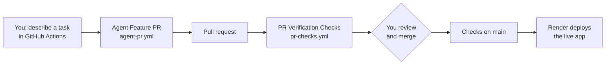

# SpotRadar

SpotRadar is a web application built with TypeScript: a REST API backend and a browser frontend that share one typed API contract.
It deliberately has no database – state lives in memory or in a local JSON file on the backend – which keeps it simple to run, test and host for free.

The app is developed mainly by AI agents (Claude Code) running in GitHub Actions: you describe a feature, an agent implements it and opens a pull request, automated checks verify it, and after merge it is deployed automatically.

**Live app:** https://spotradar.onrender.com
_(the exact address is shown in the Render dashboard; on the free plan the first request after 15 minutes of inactivity takes about a minute while the app wakes up)_

## Repository structure

```text
spotradar/
├── shared/              # API contract: shared TypeScript types, DTOs and validation schemas
├── backend/             # REST API server (serves /api and the built frontend), integration tests
├── frontend/            # Web UI, component tests and Playwright E2E tests
├── .claude/
│   ├── agents/          # AI agent definitions (team-lead, qa-reviewer)
│   ├── rules/           # Coding rules applied when agents work in backend/ or frontend/
│   └── settings.json    # Agent permissions and hooks (auto-format, checks before finishing)
├── .github/workflows/
│   ├── agent-pr.yml     # AI agent implements a task and opens a PR
│   └── pr-checks.yml    # Typecheck, lint, tests, build, E2E
├── .mcp.json            # Playwright MCP server – lets agents use a real browser
├── render.yaml          # Free deployment on Render
├── CLAUDE.md            # Project rules for humans and AI agents
└── package.json         # npm workspaces root and shared scripts
```

The project is **contract-first**: every feature starts with types and validation schemas in `shared/`, which both `backend/` and `frontend/` import – so the API and the UI cannot drift apart.

## How the AI workflow works



### 1. Agent Feature PR (`agent-pr.yml`)

Started manually: **Actions → Agent Feature PR → Run workflow**, with:

- `task` – what to implement, in plain language,
- `run_e2e` – whether to also write and run browser (Playwright) E2E tests.

The workflow creates a new branch and runs Claude Code as the **team-lead** agent, which:

1. designs the types and validation schemas in `shared/`,
2. implements the backend and frontend parts with tests,
3. runs typecheck, lint and tests and fixes failures,
4. asks the **qa-reviewer** agent for a final review.

The workflow then commits the changes and opens a pull request with a summary of test results. The agent itself is not allowed to commit or push – only the workflow does.

### 2. PR Verification Checks (`pr-checks.yml`)

Runs independently of the agent on every pull request and every push to `main`:
typecheck → lint → unit & integration tests → build → E2E tests (Playwright).
Results and logs are shown in the run summary and uploaded as an artifact.

### 3. Deployment (Render)

After a merge, the checks run on `main`; when they pass, Render builds and deploys the app automatically (`render.yaml`, `autoDeployTrigger: checksPass`). There is no separate deploy workflow and no deploy secret.

### AI agents

| Agent         | Role                                                                                                             |
| ------------- | ---------------------------------------------------------------------------------------------------------------- |
| `team-lead`   | Architect and implementer – designs the contract in `shared/`, builds backend and frontend, coordinates QA.      |
| `qa-reviewer` | Read-only reviewer – checks the diff, runs the checks and tests the running app in a browser via Playwright MCP. |

Both can also be used locally in Claude Code in this repository.

## Local development

Requires Node.js 22.

```bash
npm ci              # install dependencies
npm run dev         # start frontend + backend
npm run typecheck
npm run lint
npm test
npm run test:e2e
npm run build
npm start           # run the production build
```

## One-time setup

- **GitHub secret** `ANTHROPIC_API_KEY` (Settings → Secrets and variables → Actions) – used by the agent.
- **Settings → Actions → General → Allow GitHub Actions to create and approve pull requests.**
- **Render:** sign in at render.com with GitHub → **New → Blueprint** → select this repository.

Development rules for humans and agents are in [`CLAUDE.md`](CLAUDE.md).
